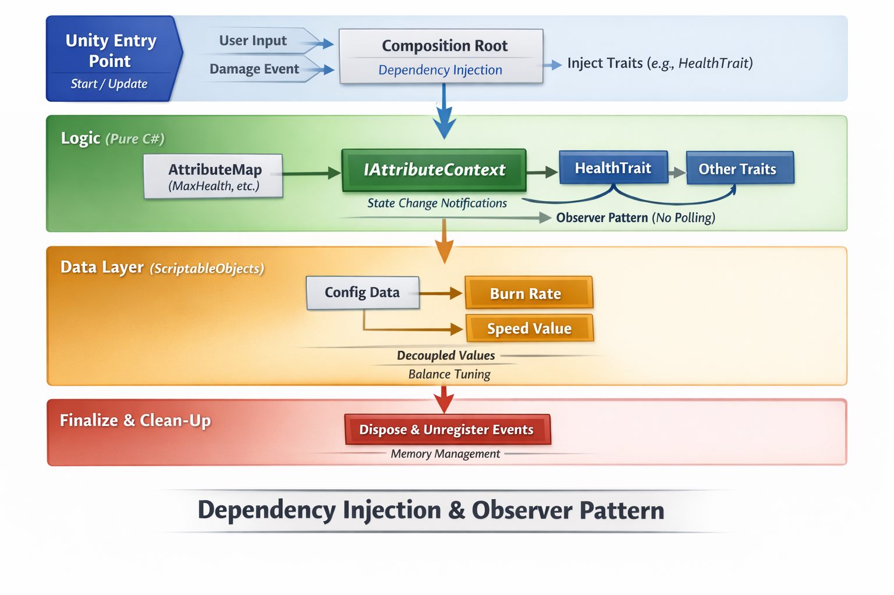

# 🧩 Unity Trait-Based Gameplay Architecture


A **production-minded learning architecture for Unity** that demonstrates how to move away from rigid `MonoBehaviour` inheritance and instead build a flexible **composition-based entity system** using **Pure C# domain logic and Clean Architecture principles**.

Traditional Unity projects often evolve into tightly coupled systems where entities accumulate dozens of responsibilities. This architecture replaces that with **Trait-based composition**, allowing gameplay behaviors to remain modular, testable, and maintainable.

---


## Current implementation and learning guide

Open `Assets/Demo/Demo.unity`, enter Play mode, focus the Game view, and press **Space**. The barrel starts at 100 health, takes 20 burn damage per second, and displays its health and burning state. Restart Play mode to reset it.

`EntityController` exposes **Starting Health** and an ordered **Trait Configs** list. Create a burn asset through **Assets → Create → Traits → Burn Configuration**. A positive extinguish threshold stops burn damage exactly at that health and clears `IsBurning`; external damage can still kill the entity. The threshold cannot exceed maximum health. Existing custom scenes using `_burnConfig` must move that asset into **Trait Configs**; the included demo is migrated.

- Core and Traits forbid Unity engine references. Data assets create fresh runtime traits by copying configuration values.
- `GameplayEntity` initializes health first, then optional traits in configuration order. Only time-based traits tick; disposal runs in reverse order, including after initialization failure.
- Attributes must be registered once with finite bounds. Writes clamp to those bounds and reject NaN/infinity and unknown IDs. Zero-valued registration is supported; notifications are synchronous and registration is silent.
- Health has a fixed maximum for one lifetime. Death fires once and stops subsequent ticks. Healing after death does not revive an entity; create a new instance for a new lifetime.
- Treat contexts as trusted, single-threaded gameplay state. Avoid cyclic writes and exceptions in observers. Dispose observers when their lifetime ends.

Read the [architecture walkthrough](docs/Architecture.md), [trait extension exercise](docs/Extending.md), and [contribution guide](CONTRIBUTING.md). This is a reference for production-minded practices, not an AAA-readiness guarantee. Networking, pooling, persistence, and large-scale scheduling are outside this example.

To integrate, copy `Assets/GameplayInfrastructure` with its `.meta` files into a compatible Unity project, attach `EntityController`, and assign configuration assets. The runtime does not require the demo, URP, or an external DI framework. Keep the asmdefs to preserve dependency boundaries.

### Run tests

Run **EditMode** and **PlayMode** from Unity's **Window → General → Test Runner**. EditMode includes domain and ScriptableObject tests; PlayMode exercises the real demo scene and object destruction.

For fast domain feedback on macOS/Linux, use Unity's bundled Mono and cached NUnit without starting the Editor:

```bash
UNITY_EDITOR="/Applications/Unity/Hub/Editor/6000.0.66f2/Unity.app/Contents/MacOS/Unity" bash scripts/test-domain.sh
```

Open the project once to resolve packages first. The script compiles Core and Traits without Unity DLLs, treats warnings as errors, runs the same attribute/entity NUnit tests, and writes `TestResults/domain.xml`. ScriptableObject and scene tests still need a licensed Unity Editor. Test results are excluded from Git.

# 🚀 Overview

Traditional Unity development frequently leads to the **"God Class" problem**, where entities like `Player` or `Enemy` accumulate excessive responsibilities:

* Health
* Movement
* Combat
* Status effects
* Inventory
* AI logic

This architecture solves that problem by treating an **Entity as a container of Traits**.

Example traits:

* `HealthTrait`
* `BurnableTrait`
* `MovementTrait`
* `CombatTrait`

Traits communicate through a centralized **Attribute Blackboard**, allowing them to remain **fully decoupled**.

Instead of calling each other directly, traits **react to attribute changes through events**, creating a **reactive gameplay system**.

---

# 🧠 Design Patterns & Principles



This architecture intentionally applies several **industry-grade engineering principles** commonly used in large-scale games.

---

## Clean Architecture (Separation of Concerns)

Core gameplay logic is written in **pure C#** without any dependency on Unity.

```
Gameplay Logic  →  Pure C#
Unity Layer     →  Adapter / Composition Root
```

The `EntityController` acts as the **adapter between Unity and the domain layer**.

Benefits:

* Gameplay logic becomes **testable without Unity**
* Core systems become **engine-agnostic**
* Clear **dependency direction**

---

## Observer Pattern (Event-Driven Gameplay)

`HealthTrait` responds to events without a per-frame method. `BurnableTrait` checks its burning state and applies time-based damage each tick.

Instead of this:

```
Update()
{
    if (health <= 0)
        Die();
}
```

Traits subscribe to attribute change events:

```
OnAttributeChanged(Health)
```

Only traits implementing `ITickableTrait` receive updates. Event-only traits react when attributes change.

Benefits:

* Reduced CPU usage
* Cleaner gameplay logic
* No `Update()` spam

---

## Dependency Injection

Traits **never search for dependencies** using `GetComponent`.

Instead, required systems are **injected during initialization**.

Example dependency:

```
IAttributeContext
```

Benefits:

* Traits become **modular**
* Easy **unit testing**
* Reduced runtime coupling

---

## Data-Driven Design

Game balance data is separated from logic using **ScriptableObjects**.

Examples:

* `BurnConfig`
* `MovementConfig`
* `WeaponConfig`

Designers can tweak gameplay values **without touching code**.

Benefits:

* Faster iteration
* Safer balancing
* Cleaner separation of data and behavior

---

# 📂 Project Structure

The project uses **Assembly Definitions (`.asmdef`)** to enforce strict dependency boundaries.

```
Assets/GameplayInfrastructure/

Core/
 ├── GameplayInfrastructure.Core.asmdef
 ├── ITrait.cs
 ├── IAttributeContext.cs
 └── AttributeHashes.cs

Data/
 ├── GameplayInfrastructure.Data.asmdef
 └── ScriptableObject configurations

Traits/
 ├── GameplayInfrastructure.Traits.asmdef
 ├── HealthTrait.cs
 ├── BurnableTrait.cs
 └── Other gameplay traits

Unity/
 ├── GameplayInfrastructure.Unity.asmdef
 └── EntityController.cs
```

---

## Layer Responsibilities

| Layer      | Purpose                                             |
| ---------- | --------------------------------------------------- |
| **Core**   | Fundamental interfaces and attribute infrastructure |
| **Data**   | ScriptableObject configurations                     |
| **Traits** | Pure gameplay domain logic                          |
| **Unity**  | MonoBehaviour adapters and system assembly          |

This ensures **clean dependency flow**:

```
Unity → Traits → Core
Unity → Data → Traits → Core
```

Core systems remain **completely independent of Unity**.

---

# ⚡ Performance Considerations

This architecture is designed with **runtime performance and GC stability in mind**.

### Zero String Allocations

The attribute system uses **explicit integer IDs** instead of strings. Despite the retained name `AttributeHashes`, IDs are no longer Unity hashes.

Example:

```
AttributeHashes.Health
```

instead of

```
"Health"
```

Benefits:

* No string allocations
* Faster dictionary lookups
* Reduced GC pressure

---

### Pre-Allocated Data Structures

Collections have initial capacities to reduce resizing. Growth, subscribers, and startup can still allocate; no zero-GC guarantee is claimed.

Benefits:

* Reduces some collection growth
* Makes initial capacity choices visible
* Requires profiling at the intended workload

---

# 🛠️ How to Use

### 1. Create an Entity

Create an empty **GameObject** in your scene.

---

### 2. Add the Controller

Attach the `EntityController` MonoBehaviour.

This acts as the **composition root** for the entity.

---

### 3. Assign Configurations

Inject configuration `ScriptableObjects` via the Inspector.

Example:

* `BurnConfig`
* `MovementConfig`

---

### 4. Initialize Traits

During startup, `EntityController` constructs and initializes the traits.

Example traits:

* `HealthTrait`
* `BurnableTrait`

---

### 5. Modify Blackboard Values

External scripts can modify the entity’s **attribute blackboard**.

Example:

```
entity.GetContext().SetValue(AttributeHashes.IsBurning, 1f);
```

Traits subscribed to that attribute will automatically react.

---

# 🎯 Example Gameplay Flow

```
External System
     ↓
Set Attribute (IsBurning = 1)
     ↓
BurnableTrait reads burning state during Tick
     ↓
BurnableTrait reduces Health
     ↓
Blackboard announces Health change
     ↓
HealthTrait raises Died at zero
     ↓
EntityController destroys the GameObject
```

No direct coupling exists between traits.

---

# 🎮 Ideal Use Cases

This architecture works best for:

* RPG systems
* Status effects
* Ability systems
* AI behavior systems
* Modular gameplay mechanics

It demonstrates reusable composition. Scalability must be measured in a representative player build.

---

# 📌 Requirements

* **Unity 6000.0.66f2** (the recorded project version; other versions need validation)
* C# 9+
* Assembly Definition support

---

# 📄 License

MIT License.

---
